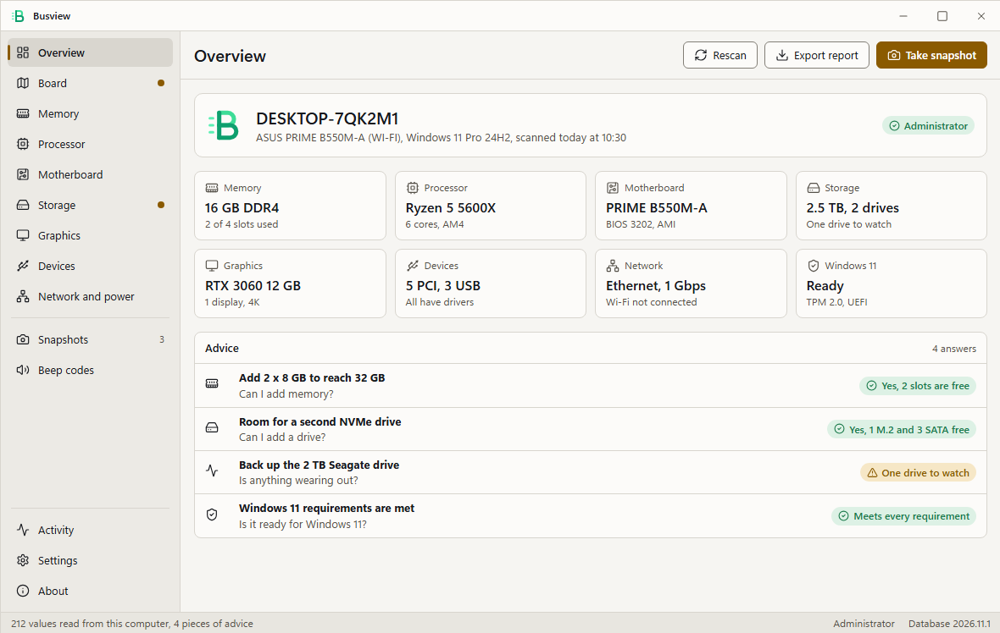
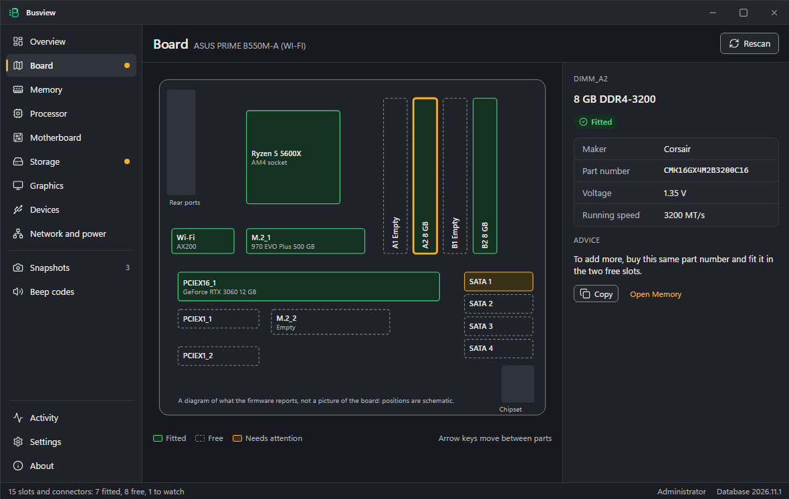

<p align="center">
  
</p>

<p align="center">
  
  
  
  
  
</p>

<p align="center">
  <a href="#what-is-busview">What it is</a> ·
  <a href="#how-will-it-tell-me-what-ram-to-buy">RAM advice</a> ·
  <a href="#what-does-it-look-like">The design</a> ·
  <a href="#what-is-it-built-with">Stack</a> ·
  <a href="#building">Building</a> ·
  <a href="#the-plan">The plan</a>
</p>

# Busview

**Busview is a Windows utility that reads what hardware is inside a computer and tells you what to do about it: what RAM to buy, what will fit, what changed, and what a beep code means.**

Busview is one of the tools of [Resolute](https://github.com/rizonesoft/Resolute), Rizonesoft's suite of Windows system utilities. It ships on its own as a single executable and is also bundled with the Resolute launcher.

Status on 2026-11-17: planned, not yet built. The scope, the tech stack, the identity and the whole interface are decided, and the plan to build them is in [`todo/`](todo/). This file records what was decided and what is still open.

## What is Busview?

Busview is a low-level hardware information tool in the same category as Speccy, CPU-Z, HWiNFO and AIDA64. Those tools show data. Busview goes one step further and gives advice from that data:

- **Can I add memory, and what do I buy?** The free slots, the limits, and the exact specification to search for.
- **Can I add a drive?** The free M.2 slots and SATA ports, and what fits them.
- **Is anything wearing out?** Each drive judged by stated rules, and against your last snapshot.
- **Is it ready for Windows 11?** Each requirement checked, and the one that fails named.

It reads and reports. It changes nothing on the computer, installs no kernel driver, and sends nothing anywhere.

## What does it look like?

The interface is designed in full: every section, both themes and every state. The working design is [`design/busview-interface.html`](design/busview-interface.html) (open it in a browser), and [`design/SPEC.md`](design/SPEC.md) is the contract for building it 1:1. These are captures of the design with example data, not of a built program.

<p align="center">
  
  
</p>

| Section | What it holds |
| --- | --- |
| Overview | The computer in one screen, and the advice Busview has for it |
| Board | A diagram of the slots and connectors: fitted, free, needs attention |
| Memory, Processor, Motherboard, Storage, Graphics, Devices, Network and power | Every value Busview read for that part, with a plain-language line under each when Explain is on |
| Snapshots | Saved states of the computer, and the comparison of any two |
| Beep codes | What a BIOS beep pattern means and what to try |
| Activity, Settings, About | The suite's shared sections |

## What will it show?

Everything below can be read from user mode, with no kernel driver. Most of it needs no administrator rights.

| Area | What Busview reads | Where it comes from |
| --- | --- | --- |
| Motherboard and BIOS | Maker, model, BIOS version, memory slots, chassis | SMBIOS tables through `GetSystemFirmwareTable` |
| Firmware | ACPI tables, TPM and Secure Boot state | `GetSystemFirmwareTable` and Windows APIs |
| Processor | Model, features, cache, core layout | The `CPUID` instruction |
| Devices | PCI and USB devices, their IDs and drivers | SetupAPI and CfgMgr32, hub IOCTLs |
| Storage | Drives, and SMART and NVMe health logs | Storage IOCTLs (health needs administrator rights) |
| Displays and graphics | Monitor EDID, adapter details | The registry, DXGI, and the vendor APIs (NVAPI, ADL) |
| Other | Battery, network adapters | Windows APIs |

## What needs a kernel driver?

Live sensors and a few deep details need ring 0 access:

- **Model-specific registers:** per-core temperature, power draw (RAPL), microcode details.
- **Super I/O chips:** fan speeds, voltages and board temperatures.
- **SMBus:** the SPD chip on each memory module (exact timings, XMP and EXPO profiles, module temperature).
- **Embedded controller** and raw PCI configuration space.

The driver is the hard part of this category:

- Writing one means an EV certificate, Microsoft attestation signing and compatibility with memory integrity (HVCI). A driver that exposes register or port access to user mode is also what attackers reuse.
- WinRing0, the old shortcut, is flagged by Microsoft Defender and is on the vulnerable driver blocklist.
- The practical route is PawnIO, a signed driver that runs small sandboxed modules. LibreHardwareMonitor and FanControl are believed to have moved to it in 2025. Verify that before relying on it.

Decision: version 1 is driverless. Sensors come later, as an optional layer, if at all.

## How will it tell me what RAM to buy?

This is the first use case, and almost all of it works without a driver.

| Question | Source | Driver needed |
| --- | --- | --- |
| How many slots, and which are empty | SMBIOS memory tables | No |
| Type (DDR4 or DDR5) and form factor (DIMM, SODIMM, soldered) | SMBIOS | No |
| Size, speed, voltage, maker and part number of each fitted module | SMBIOS | No |
| Maximum capacity the board supports | SMBIOS | No, but vendors often fill it in wrongly |
| Exact timings and XMP or EXPO profiles | SPD over SMBus | Yes |
| What the processor supports (maximum memory and speed) | The CPUID model plus a table Busview maintains | No |

A first version can say "2 of 4 slots used, 2 x 8 GB DDR4-3200 SODIMM, this part number, board maximum 64 GB". That is enough to buy a matching module.

Known limits:

- **Firmware data quality:** SMBIOS is only as good as the vendor's firmware. Cheap boards and some laptops report empty part numbers or a wrong maximum.
- **Soldered memory:** usually detectable, but not on every laptop.
- **Tested-memory lists:** Busview can recommend a specification. It can only name a guaranteed kit where the compatibility database has one, and version 1 does not carry those lists.
- **The Board diagram is schematic.** It draws the slots the firmware reports. It does not know where they sit on the real board, and it says so.

## What is in the compatibility database?

One SQLite file, read-only, shipped beside the executable and updated separately from the program. Every row carries its source and the date it was taken.

It is built in four layers:

1. **Rules from the machine itself:** type, form factor, speed and free slots. This always works and needs no data.
2. **Board and system specifications:** maximum capacity, supported speeds and M.2 slot types, keyed on the SMBIOS board and system IDs.
3. **Maker-tested kits:** the tested-memory lists that ASUS, MSI, Gigabyte and ASRock publish per board. Thousands of boards with hundreds of kits each, revised with BIOS updates.
4. **Opt-in reports from users:** the only realistic way to cover laptops. It needs a server and a privacy policy.

Version 1 ships layers 1 and 2. A module that matches the type, form factor, speed and capacity limits works in the large majority of machines, so those two layers answer "what do I buy" for most people. Layer 3 is the most work for the least gain, and neither it nor layer 4 is started before people are using the tool.

## Where do the BIOS beep codes come from?

BiosCodes, a Rizonesoft tool that explains BIOS beep codes, is folded into Busview. Its 177 codes for seven BIOS makers (AMI, AST, Award, Compaq, Dell, IBM and Phoenix) become one table of the database, and Busview opens the list on the maker your BIOS reports.

- **The source the codes are taken from:** [`reference/beepcodes-au3/`](reference/beepcodes-au3/), the AutoIt script, its text table and its three language packs.
- **The retired repository:** BiosCodes left the Resolute suite as a separate tool on 2026-11-17 and its GitHub repository was deleted. The last clone and a bundle of its history are kept on the owner's machine and are not part of this repository.

The code is Rizonesoft's own, under GPL v3, as Busview is.

## What is it built with?

The stack was settled on 2026-11-17.

- **Language:** C++23. It gives direct access to CPUID, the firmware tables and the storage IOCTLs, and SQLite is a C library.
- **Toolchain:** [Resolute-SDK](https://github.com/rizonesoft/Resolute-SDK) at the commit `sdk.json` pins: llvm-mingw, CMake and Ninja.
- **Tests:** Catch2 v3.
- **Interface:** `resolute-ui`, the suite's Direct2D library. The window is the suite's tool window, so a person who has used one Resolute tool has used Busview.
- **Database:** SQLite, read-only at run time. The rows live in the repository as text files, each with its source and date, and a Python script compiles them at build time.
- **Graphics vendor APIs:** NVAPI and ADL are reached by loading the DLLs the graphics driver installs and calling their C interfaces at run time. No vendor SDK is linked or shipped, and a missing DLL means that detail is skipped. This is unproven on llvm-mingw, so the plan proves it first.
- **Snapshots:** one versioned JSON document per snapshot.
- **Crash handling:** built in. A crash writes a minidump and a short text report beside the program. Nothing leaves the machine.
- **Packaging:** a portable zip and an Inno Setup installer.
- **Code signing:** Rizonesoft's existing certificate and process.
- **Safety:** firmware tables are untrusted input. Every parser reads through one bounds-checked reader and is tested with malformed input.

## What is in version 1?

- The driverless hardware inventory.
- Advice on memory, storage, drive health and Windows 11 readiness, from database layers 1 and 2.
- Snapshot and compare.
- The beep codes.
- A report export that hides serial numbers by default, and a command line that scans without a window.

Later, in the order they were rated: processor upgrade suggestions, a used-PC report for buyers and sellers, WinPE support for rescue USBs, hand-off to makers' memory finders, live sensors through PawnIO, the tested-kit lists and opt-in user reports.

## Building

Nothing builds yet: the first section of the plan writes the build. What works today, on Windows 10 or 11 x64 with Git, PowerShell 7 and Python 3:

```powershell
git clone https://github.com/rizonesoft/Busview.git
cd Busview
pwsh scripts/sdk.ps1                      # fetches Resolute-SDK at the commit sdk.json pins, into sdk/
python brand/build.py --check             # the brand assets are what the script builds
python scripts/todo-graph.py validate     # the plan is well formed
python design/capture.py --list           # the screens and states of the interface design
```

## The plan

The whole of version 1 is planned as 48 sections in [`todo/00-busview/TODO-01-busview.md`](todo/00-busview/TODO-01-busview.md), and [`todo/implementation-plan.md`](todo/implementation-plan.md) is its generated view. Each section is small, names its files and its test, and closes only after an independent review.

| Phase | What it delivers | Sections |
| --- | --- | ---: |
| 0 | The build, the gates, the crash handler, the checked reader | 5 |
| 1 | Reading the machine: every hardware reader | 13 |
| 2 | The database and the four pieces of advice | 7 |
| 3 | Snapshots, comparison, beep codes, report export, database updates, the command line | 7 |
| 4 | The window, section by section, 1:1 with the design | 11 |
| 5 | Language pack, the portable zip, the installer and the documents | 3 |
| 99 | Code signing and name clearance, for the owner | 2 |

Phases 0 to 3 need nothing but this repository and the pinned SDK. Phase 4 waits on Resolute-SDK: its tool window, buttons, dialogs, text boxes and accessibility support are planned there and not built yet, and Busview does not draw its own copies of them.

### Running the plan

`pwsh scripts/start-run.ps1` starts an agent session in this checkout that works through the plan with the `process-plan` skill; `-Runner agy` starts it in Antigravity instead. `pwsh scripts/start-run.ps1 -InstallShortcut` writes two desktop shortcuts, "Busview Claude campaign" and "Busview Carbon campaign", each with Busview's icon and its runner's badge. They go on the Desktop itself, not in the Resolute Bin folder. A run starts only when you start it: closing its window, a crash or a reboot ends it, and nothing restarts it.

## Repository layout

| Path | Purpose |
| --- | --- |
| `design/` | The interface contract (`SPEC.md`), the working design and its captures |
| `brand/`, `DESIGN.md` | The identity, built by `python brand/build.py`, and the window's sections |
| `todo/` | The plan |
| `reference/beepcodes-au3/` | The AutoIt BiosCodes source the beep codes come from |
| `sdk.json`, `scripts/sdk.ps1` | The Resolute-SDK pin and the script that fetches it |
| `scripts/`, `.conclave/`, `docs/` | The plan, review and run tooling from Conclave-SDK |
| `AGENTS.md` | What this repository is and the rules for working in it |

## Why the name Busview?

It hints at the buses the tool reads: PCI, USB and SMBus. Other names considered were Assay, Sextant, Keel, Surveyor, Baseboard and HardwareInspector.

What a quick search on 2026-11-17 found:

- No current product called Busview in this category.
- A United States trademark for BUSVIEW was registered in 2002 and cancelled in 2011. This was a search, not a legal clearance.
- Search results will be noisy: Microsoft's USBView is one letter away, and "bus" pulls in school-bus and transit software.

Clearing the name is a planned owner decision before the first release.

## What is still open?

- **Sensors:** whether they are in scope at all, since that decides the driver question.
- **Data sourcing:** the legal check on collecting the makers' tested-memory lists.
- **User reports:** the server, the privacy policy and the opt-in wording.
- **Funding:** free, paid, or affiliate links.
- **Name clearance:** trademark, domain and package names.

## What already exists in this space?

- **Speccy, CPU-Z, HWiNFO, AIDA64:** the established viewers. None gives upgrade advice or compares snapshots well.
- **NWinfo:** an open-source Windows hardware information tool, worth reading before starting. Documentation: <https://a1ive.github.io/nwinfo/docs/>
- **LibreHardwareMonitor:** the open-source reference for sensors.
- **USBView:** Microsoft's USB tree viewer. Documentation: <https://learn.microsoft.com/windows-hardware/drivers/debugger/usbview>
- **BUSVIEW trademark record:** <https://trademarks.justia.com/756/14/busview-75614501.html>

## Licence

Busview is free software under the [GNU General Public License v3](LICENSE). Resolute-SDK, which it builds on, is under the MIT licence. The fonts in `brand/fonts/` are under the SIL Open Font License, and the Lucide icon script in `design/` is under the ISC licence.

Copyright Rizonesoft.
